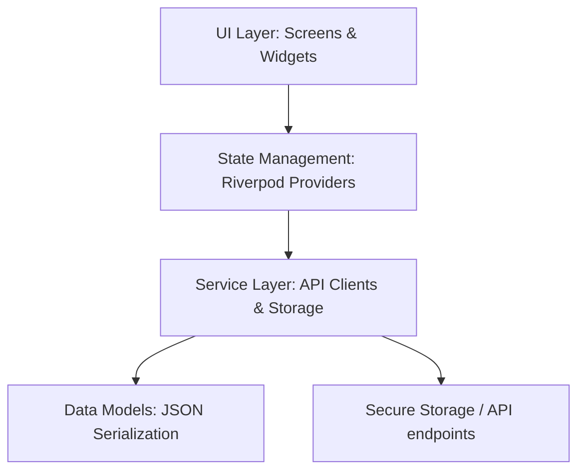

# SAASORDER partnerPro - Project Documentation

Welcome to the official developer documentation for the **partnerPro** mobile application. This guide outlines the project's architecture, file structure, key modules, authentication strategy, feature workflows, and design tokens to help developers onboard and contribute efficiently.

---

## 📖 Project Overview
**partnerPro** is a cross-platform mobile application built using **Flutter**. Designed specifically for **SAASORDER**, the application serves as a portal for partners, sales agents, and administrators:
- **Partners & Sales Agents** can track their direct sales, referral commissions, check available balances, view detailed commission statements, convert balances across currencies, and request payouts (redemption).
- **Administrators** can view performance overviews, audit salesperson-specific orders, track referral pipelines, and review incentive reports.

---

## 🏗️ System Architecture & Technology Stack

The application follows clean architecture principles, utilizing reactive programming and clean division of layers:



### 1. Core Framework
- **Flutter (Dart SDK `^3.10.4`)**: Target platforms include Android, iOS, Windows, macOS, Linux, and Web.

### 2. State Management
- **Flutter Riverpod (`^3.3.1`)**: Employs unidirectional data flow and reactive caching. Providers manage authentication status, dashboard metrics, statement filters, and redemption flows.

### 3. Networking
- **Dio (`^5.9.0`)**: Used for robust HTTP networking. Features include:
  - Custom timeouts (e.g., 10-second limits during dual-server authentication).
  - Explicit header setups (JWT Bearer tokens, Content-Type overrides).
  - Dynamic URL constructions and redirect sanitization.

### 4. Storage & Security
- **Flutter Secure Storage (`^9.2.4`)**: Securely persists JWT tokens (`access_token`, `refresh_token`) on the device keychain/keystore.
  - *Decryption Failure Recovery*: Handles platform-specific decryption exceptions (such as Android Keystore key rotation or corruption producing a `BadPaddingException`). If secure storage reads fail, the session manager automatically wipes all stored credentials (`deleteAll()`) and requests a clean login instead of letting the app crash.

### 5. Typography & Theme
- **Google Fonts (`8.1.0`)**: Dynamically loads the **Roboto** font.
- **Material 3 UI**: Full compatibility with Google's Material 3 specification.

---

## 📂 Project Structure

Below is the directory structure under the `lib/` root:

```text
lib/
├── main.dart                 # Application entry-point & navigation bootstrap
├── theme/
│   └── app_colors.dart       # Design system color tokens
├── models/
│   ├── admin_models.dart     # Models representing admin dashboard and reports
│   ├── auth_session.dart     # Authentication state and role structures
│   ├── auth_user.dart        # User profile fields and display formatters
│   ├── dashboard_data.dart   # Dashboard statistics and order lists
│   ├── redemption_balance.dart
│   ├── redemption_response.dart
│   ├── sales_report.dart
│   ├── statement_order.dart  # Commission statements
│   └── view_more_data.dart
├── services/
│   ├── api_config.dart       # Normal vs Admin URL router and parser
│   ├── auth_service.dart     # Dual-server login procedures
│   ├── auth_storage.dart     # JWT credentials persistence
│   ├── admin_service.dart    # Administrative reports API calls
│   ├── dashboard_service.dart# Orders fetching and commission analytics
│   ├── redemption_service.dart# Payout operations and currency conversions
│   ├── permission_service.dart# JWT decoder and permission checks
│   └── statement_service.dart# Statement lists fetching
├── providers/
│   ├── auth_provider.dart    # Riverpod auth state notifier
│   ├── dashboard_provider.dart# Riverpod dashboard state notifier
│   ├── statement_provider.dart# Riverpod statements and filter notifiers
│   └── redemption_provider.dart# Riverpod redemption transaction state
├── screens/
│   ├── login_screen.dart     # Authentication UI
│   ├── signup_screen.dart    # User registration UI
│   ├── dashboard_screen.dart # User landing page with orders
│   ├── statement_screen.dart # Detailed list of commissions and filtering
│   ├── redeem_request_screen.dart # Submit payout form
│   ├── redeem_details_screen.dart # Redemption status and history
│   ├── view_more_screen.dart # Paginated order scroll view
│   └── admin/
│       ├── admin_dashboard_screen.dart           # Admin entry point
│       ├── admin_all_salesperson_orders_screen.dart # Filter orders by salesperson
│       ├── admin_all_referral_orders_screen.dart    # Track referral orders
│       └── admin_incentive_report_screen.dart        # Inspect agent reports
└── widgets/
    ├── custom_text_field.dart# Standard styled input field
    └── permission_denied_widget.dart # Access control boundary UI
```

---

## 🔐 Authentication & Permission Routing

One of the application's unique patterns is its **dual-server authentication routing strategy**.

### The Multi-Server Flow
Because users can exist on different backends depending on whether they are admins or normal partners, `AuthService.login()` performs the following:

1. **Phase 1: Admin Endpoint Check**
   Attempts a POST login request to the **Admin Base URL** (`https://americas-jonathan-interventioFluns-mysql.trycloudflare.com/api/v1/dashboard/login/`).
   - If the request succeeds and the decrypted JWT contains an array of `permissions`, the user is logged in as an **Admin** (`UserRole.admin`).
   - If successful but no permissions are embedded, it assumes this email is a standard portal user and falls back to Phase 2.
2. **Phase 2: Normal Portal Fallback**
   Attempts login against the **Normal Base URL** (`https://partnerpro.saasorder.com/api/v1/dashboard/login/`).
   - If successful, logs the user in as a **Normal User** (`UserRole.normal`).
3. **Session Setup & Overrides**
   Instantiates an `AuthSession` with the credentials, decrypts user payloads, and configures the `PermissionService` instance before saving keys via `AuthStorage`.
   - *Special Case*: If the parsed `user_type` of the user is `"end_user"`, the session role is explicitly overridden to **`UserRole.normal`**, ensuring they bypass all administrative dashboards.

---

## 📱 Core Feature Modules

### 1. User Dashboard (`dashboard_screen.dart`)
Acts as the central cockpit for sales partners and clients.
- **Segmented Tabs (Partners Only)**: Splits orders into **Direct Orders** (where `referral_details` is empty) and **Referral Orders** (where `referral_details` contains items).
- **Single-Screen View (End Users Only)**: For users with `user_type == 'end_user'`, the tab controller/tab bar are hidden and the dashboard functions as a standard, single-view screen displaying only their own direct orders.
- **KPI Summary Cards**:
  - *Total Commission*: Calculated locally based on the currencies of active orders.
  - *Approved / Pending Counters*: Dynamically counts verified vs. pending transactions.
- **Order Details Bottom Sheet**: Clicking any order reveals an expandable pane with transaction parameters, participant names, and order item breakdowns (product, quantity, unit price, and subtotal).

### 2. Commission Statement & Filters (`statement_screen.dart`)
Tracks available wallet balance and lists all previous commission payouts.
- **Date Filters**: Filter transactions using a start and end calendar picker.
- **Running Balances**: Generates a cumulative transaction trail showing how balances change with each credit.
- **Redemption Dialog Launch**: Easy gateway to convert balance values directly from this page.

### 3. Redemption & Currency Exchange (`redemption_service.dart`)
Supports multicurrency payouts.
- **Currency Convert**: Converts available AED balance to external currencies (`INR`, `USD`, `SAR`, `OMR`, `AED`) using `/api/v1/sales-agent-management/redemption/convert/`.
- **Withdrawal Requests**: Submits bank transfer payloads (Account Number, Account Name, Destination Country, IFSC/SWIFT code, Payout Amount, and Selected Currency) via `/api/v1/sales-agent-management/redemption/`.

### 4. Admin Portal (`lib/screens/admin/`)
Restricted to users with valid administrative JWT permissions. Screens, dashboard cards, and navigation drawer links are conditionally filtered and displayed based on specific Django permission scopes retrieved from the JWT token via `PermissionService`:
- **Salesperson Performance Auditing**: Requires the **`order_management.view_orders`** permission to display the `AdminAllSalespersonOrdersScreen` card/menu (fetches from `/api/v1/dashboard/all-salesperson-orders/`).
- **Referral Tracker**: Requires the **`order_management.view_referralsalesperson`** permission to display the `AdminAllReferralOrdersScreen` and `AdminReferralOrdersScreen` cards/menus (fetches from `/api/v1/dashboard/all-referral-orders/`).
- **Incentive Reports**: Requires the **`sales_agent_management.view_salesincentivereport`** permission to display the `AdminIncentiveReportScreen` card/menu (fetches from `/api/v1/sales-agent-management/staff/sales-report/`).

---

## 🌐 API Integrations & Configurations (`api_config.dart`)

The API Layer contains safeguards for handling redirects, prepending proper protocol schemas (HTTP vs HTTPS), and resolving trailing slash redirects.

| Feature Area | Base URL | Endpoints |
| :--- | :--- | :--- |
| **Auth / Login** | Admin / Normal | `/api/v1/dashboard/login/` |
| **Normal Orders** | `https://partnerpro.saasorder.com` | `/api/v1/order-management/orders/` |
| **Normal View More** | `https://partnerpro.saasorder.com` | `/api/v1/dashboard/view-more/` |
| **Balance Redemption** | `https://partnerpro.saasorder.com` | `/api/v1/sales-agent-management/redemption/` |
| **Redemption Balance** | `https://partnerpro.saasorder.com` | `/api/v1/sales-agent-management/redemption/balance/` |
| **Redemption Convert** | `https://partnerpro.saasorder.com` | `/api/v1/sales-agent-management/redemption/convert/` |
| **Admin All Salesperson Orders** | `adminBaseUrl` | `/api/v1/dashboard/all-salesperson-orders/` |
| **Admin Sales Report** | `adminBaseUrl` | `/api/v1/sales-agent-management/staff/sales-report/` |
| **Admin Referral Orders** | `adminBaseUrl` | `/api/v1/dashboard/all-referral-orders/` |

---

## 🎨 Theme & Design System Color Codes (`app_colors.dart`)

The visual design uses a dark-blue and teal layout optimized for contrast, readability, and modern dashboard visual guidelines:

| Token | Hex Value | Application |
| :--- | :--- | :--- |
| **`primaryBlue`** | `#1E2B7B` | Main brand color, AppBars, Primary Buttons, gradients |
| **`secondaryTeal`** | `#53D3AF` | Accent details, positive wallet numbers, active borders |
| **`backgroundLight`** | `#F5F9FA` | Page body scaffolding background |
| **`cardBackground`** | `#FFFFFF` | Individual panels, list item cards, sheets |
| **`textDark`** | `#1A1A1A` | Main page typography |
| **`textGrey`** | `#666666` | Secondary subtitles, helper labels, place-holders |
| **`pendingYellow`** | `#FFD166` | Pending state badges, warning indicators |
| **`approvedGreen`** | `#06D6A0` | Approved transaction indicators, credit highlights |
| **`accentBlue`** | `#118AB2` | Secondary system notifications and icons |

---

## 🚀 Getting Started & Local Development

1. **Install Dependencies**:
   ```bash
   flutter pub get
   ```
2. **Run Application**:
   - For debug mode:
     ```bash
     flutter run
     ```
   - For build:
     ```bash
     flutter build apk  # (or ios/appbundle/windows/macos/web)
     ```
3. **Lint Rules**:
   Custom rules are configured in `analysis_options.yaml` enforcing standard styling, sorting imports, and type safety constraints. Please run `flutter analyze` before committing.
